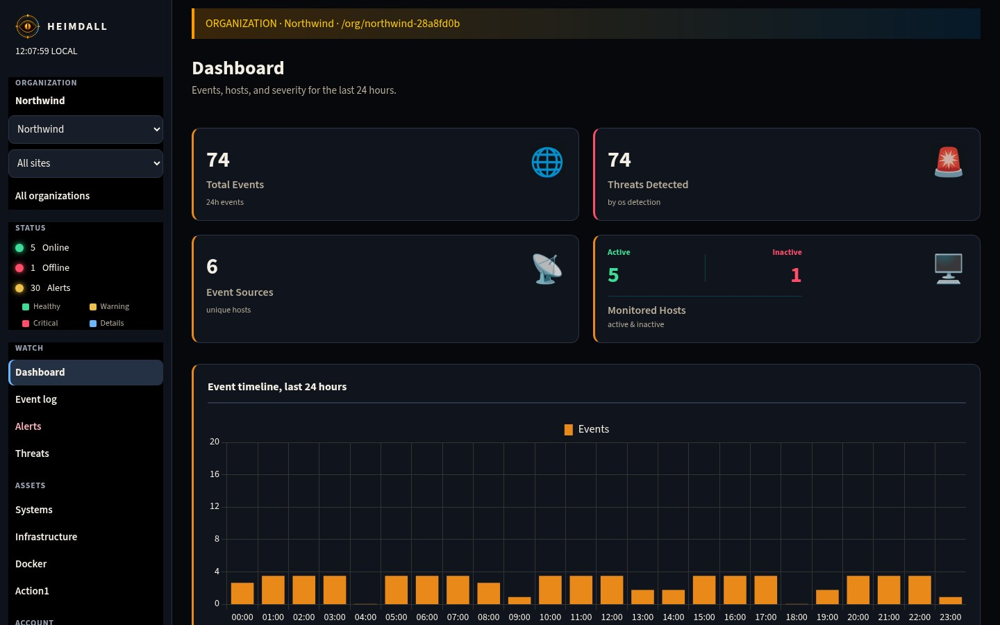
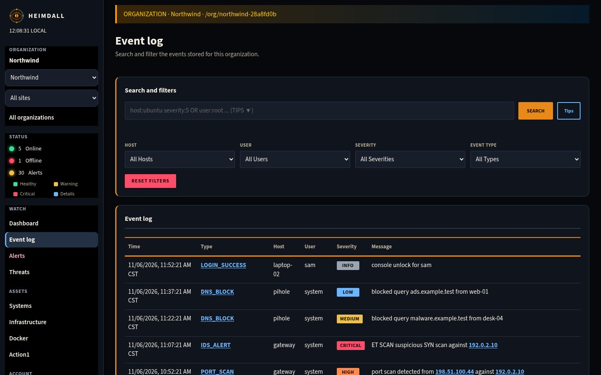
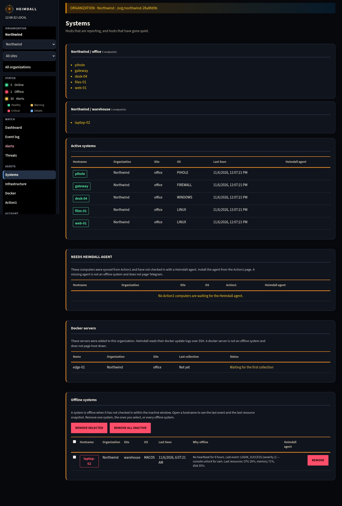
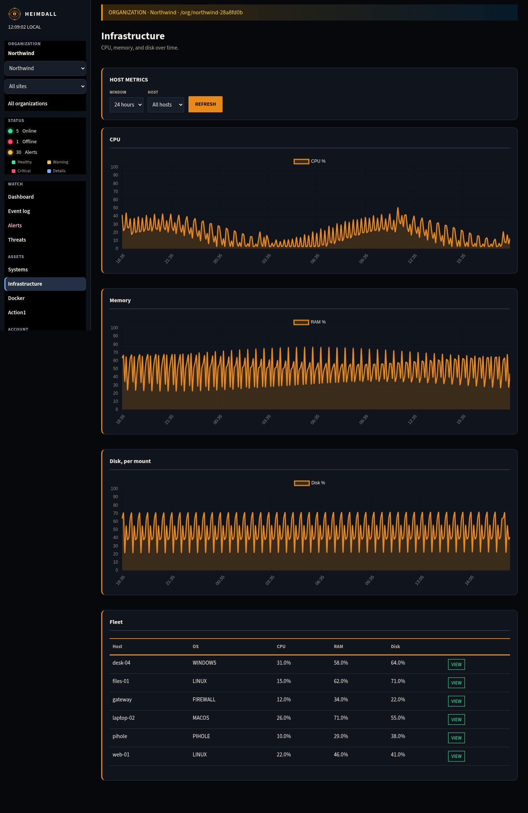
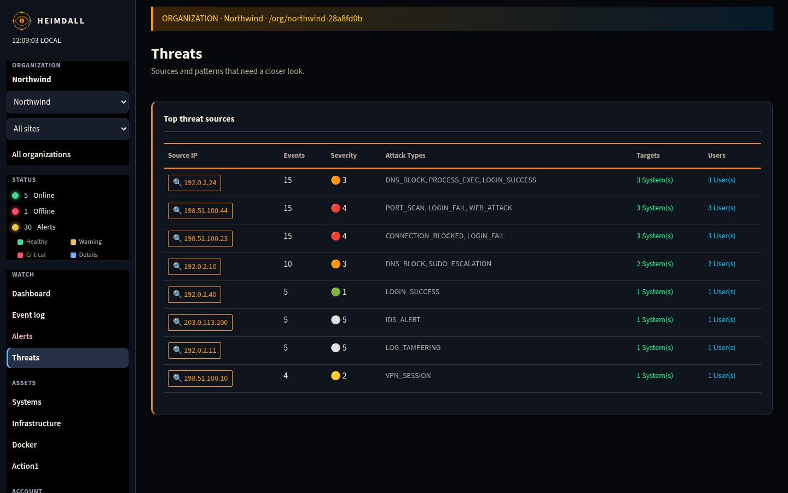
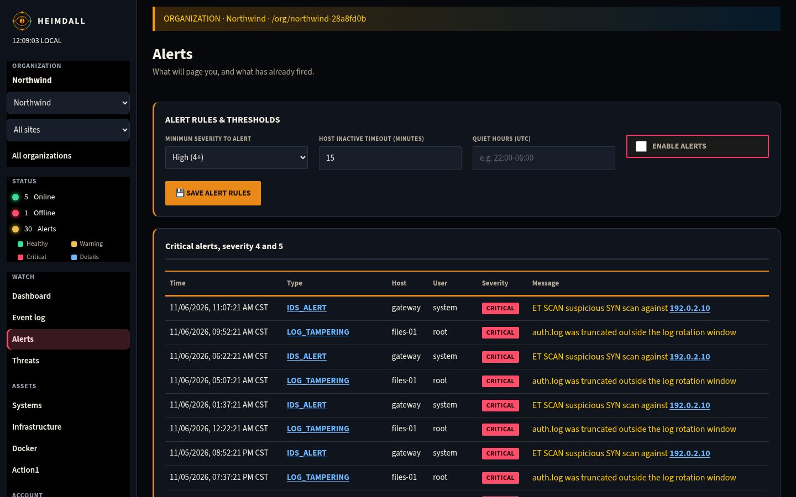
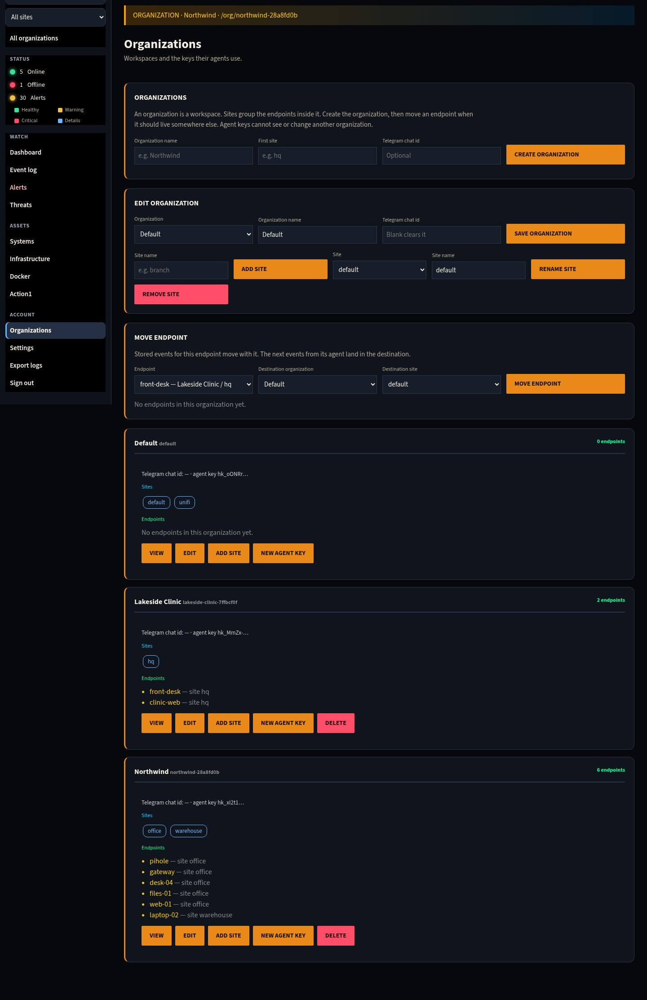
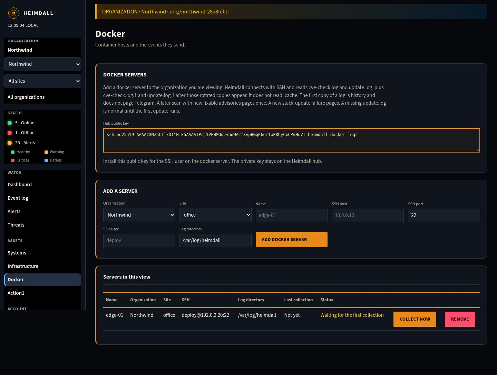
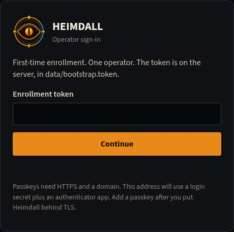

# Heimdall

Heimdall is a small SIEM and host monitor. Agents on Linux, Windows, macOS, firewalls, and Pi-hole send security events and resource metrics to one hub. The dashboard is split by organization, so one hub can watch many customers without mixing their data.

The pictures on this page are from a local demo. Hosts such as `web-01` and `gateway`, and addresses in `192.0.2.0/24`, `198.51.100.0/24`, and `203.0.113.0/24`, are fictional.



## What it does

- **SIEM.** Failed logins, sudo, account changes, log tampering, firewall blocks, Pi-hole DNS blocks, and related events, normalized to one schema.
- **Host health.** CPU, memory, and disk as a time series, plus the latest snapshot for each host.
- **Organizations.** Each customer is a workspace at `/org/<slug>`. Sites group hosts inside an organization (office, warehouse, hq).
- **Alerts.** Telegram for high-severity events, hosts that go quiet, and CPU, memory, or disk that stay high.
- **Docker hosts.** The hub reads `cve-check.log` and `update.log` over SSH. A new fixable advisory, or a new update failure, pages once.
- **Agents.** Linux (systemd and a Python venv), Windows (PowerShell scheduled task, no Python), macOS, firewall, and Pi-hole.

## A tour

Open the dashboard at `http://YOUR_HUB_IP:8501`. With one organization, it opens that workspace. The sidebar switches organization and site. **All organizations** is the operator overview.

### Event log

Search and filter stored events. `host:web-01 AND severity:4`, `user:root OR user:admin`, and a quoted phrase from the raw message all work.



### Systems

Hosts are grouped by site. A host is offline when it has not checked in within the inactive window. Computers that exist only in Action1 are listed under **Needs Heimdall agent** and do not page host-down. Docker servers are listed on their own and do not page host-down either.



### Infrastructure

CPU, memory, and disk for the selected window, and the latest value for each host.



### Threats

Source addresses ranked by how often they appear and how severe those events were.



### Alerts

Set the minimum severity, how long a host can stay quiet, and quiet hours in UTC. Severity 4 and 5 events are listed under the form.

Telegram sends plain text. A Docker CVE check and the updater it starts are one message: the advisory ids, each failure, and whether the run finished. The same failure is not sent again as its own page.



### Organizations

Create an organization, add sites, and move a host when it should live somewhere else. Creating an organization shows an agent API key once. The board afterwards shows only a short prefix. Give each client machine that organization's agent key, not the hub operator key.



### Docker

Add a docker server to the organization you are viewing. Heimdall connects with its own SSH key and reads the CVE and update logs, including the rotated `.1` copies. It does not read `.cache`. The first copy of a log is history and does not page. The public key in the picture belongs to the demo hub.



### Sign-in

The first boot writes a one-time enrollment token to `data/bootstrap.token` on the hub (mode 600), unless you set `SIEM_BOOTSTRAP_TOKEN`. Open the dashboard, enter that token, and enroll an authenticator app. On plain HTTP the second factor is a login secret plus the authenticator. Passkeys need HTTPS and a domain (`SIEM_ORIGIN` and `SIEM_RP_ID`). Ten recovery codes are shown once.

Until an operator enrolls, a private LAN can open the console. After enrollment, the browser holds a session. It never receives the operator API key.



Action1 is the remaining nav item. It syncs managed endpoints, missing updates, and vulnerabilities from an Action1 account, and it can hand the Windows installer to the machines you tick. It does not install other software or start remediations. There is no screenshot here because that page needs a real Action1 account.

## Architecture

```
  Linux / Windows / macOS / firewall / Pi-hole agents
                    |
                    |  POST /ingest, /system-status, /heartbeat
                    v
         Heimdall hub (FastAPI + PostgreSQL)
                    |
                    +--> Dashboard  :8501   /org/<slug>
                    +--> API        :8010
                    +--> Syslog     :5514/udp
                    +--> Telegram
```

- **Hub.** FastAPI (`core/server_api.py`) and PostgreSQL (`core/database_pg.py`).
- **Dashboard.** `ui/index.html`, served by `ui/dashboard_server.py`.
- **Tenancy.** The operator key sees every organization. An agent key is scoped to one organization. Two organizations may both have a host named `web-01`.

## Hub

```bash
cp config.example.txt .env
# Set SIEM_API_KEY. Add Telegram there if you use it.

docker compose up --build -d
```

- Dashboard: `http://YOUR_HUB_IP:8501`
- API health: `http://YOUR_HUB_IP:8010/health`

`deploy.sh` rsyncs the tree and runs compose on another machine. It does not overwrite an existing remote `.env`.

```bash
REMOTE_USER=deploy REMOTE_HOST=YOUR_HUB_IP bash deploy.sh
```

Ports:

| Port | Use |
|---|---|
| 8501 | Dashboard |
| 8010 | Agent API and installers |
| 5514/udp | UniFi and other syslog |

Keep 8010 and 5514 on the LAN or a VPN. Do not publish them on the public internet. Leave `SIEM_PUBLIC` unset for a private hub. Public mode is optional and expects HTTPS (`SIEM_ORIGIN`, `SIEM_RP_ID`). The Compose `public` profile is a Caddy front door. See `deploy/Caddyfile`.

UniFi syslog setup: [docs/UNIFI.md](docs/UNIFI.md).

## Agents

Each machine needs one command. The hub URL and the organization agent key are required. Pass `--site` on Linux when the host belongs somewhere other than `default`. The installer registers a service, writes its config, and checks in before it reports success. Run the same command again to upgrade.

```bash
# Linux
curl -fsSL http://YOUR_HUB_IP:8010/install/linux | sudo bash -s -- --key YOUR_API_KEY --site office

# Linux firewall or Pi-hole
curl -fsSL http://YOUR_HUB_IP:8010/install/linux | sudo bash -s -- --key YOUR_API_KEY --site office --role firewall --firewall-type ufw
curl -fsSL http://YOUR_HUB_IP:8010/install/linux | sudo bash -s -- --key YOUR_API_KEY --site office --role pihole

# macOS
curl -fsSL http://YOUR_HUB_IP:8010/install/macos | sudo bash -s -- --key YOUR_API_KEY
```

```powershell
# Windows (elevated PowerShell). No Python install.
powershell -ExecutionPolicy Bypass -Command "& ([scriptblock]::Create((Invoke-RestMethod http://YOUR_HUB_IP:8010/install/windows))) -ApiKey YOUR_API_KEY"
```

From a copy of the repo, the Linux values can be positional: URL, org key, site, hostname, interval.

```bash
sudo ./agents/install_linux_agent.sh http://YOUR_HUB_IP:8010 ORG_AGENT_KEY office web-01 30
```

| System | Service | Config |
|---|---|---|
| Linux, firewall, Pi-hole | `heimdall-agent` (systemd) | `/etc/heimdall/agent.env` |
| macOS | `com.heimdall.agent` (LaunchDaemon) | `/etc/heimdall/agent.env` |
| Windows | `HeimdallAgent` (scheduled task) | `C:\ProgramData\Heimdall\agent.env` |

Short site names (`office`) are stored as `<org-id>-office`. Logs on Linux: `journalctl -u heimdall-agent -f`.

Uninstall, hostname override, and firewall log paths: [docs/AGENT_INSTALLATION.md](docs/AGENT_INSTALLATION.md).

## Dashboard

| Nav | Purpose |
|---|---|
| Dashboard | Event volume, severity, and host counts for the last 24 hours |
| Event log | Searchable events |
| Alerts | Severity, inactive window, quiet hours, and critical events |
| Threats | Source addresses ranked by count and severity |
| Systems | Hosts by organization and site, including offline hosts |
| Infrastructure | CPU, memory, and disk over a time window |
| Docker | SSH log collection for docker update hosts |
| Action1 | Sync managed endpoints and hand out the Windows installer |
| Organizations | Create organizations, sites, and agent keys |
| Settings | Time zone and console sign-in |

Deep link: `http://YOUR_HUB_IP:8501/org/<slug>`

## API

| Path | Role |
|---|---|
| `POST /ingest` | SIEM events |
| `POST /system-status` | Latest snapshot and metric samples |
| `POST /metrics/samples` | Append metric samples directly |
| `GET /metrics/query` | Time-window host metrics |
| `POST /heartbeat` | Agent liveness (`source-host`, `os-type`, `source-site`) |
| `GET /events`, `GET /hosts` | Scoped by organization and site |
| `GET /orgs`, `POST /clients` | List and create organizations |
| `POST /clients/{id}/sites` | Add a site |
| `POST /clients/{id}/rotate-key` | Replace that organization's agent key |
| `GET /install/linux`, `/install/macos`, `/install/windows` | Agent installers |
| `GET /health` | Liveness, no authentication |

The operator key is `SIEM_API_KEY` in `.env`. From the network it can still post ingest, heartbeat, system status, and metric samples. Reads and console changes with that key are accepted from loopback. Agent keys are minted per organization in the dashboard.

## Configuration

See `config.example.txt`. Generate the operator key with `openssl rand -hex 32`.

```
SIEM_API_KEY=...
SIEM_API_URL=http://YOUR_HUB_IP:8010
TELEGRAM_BOT_TOKEN=...
TELEGRAM_CHAT_ID=...
```

`TELEGRAM_CHAT_ID` is the fallback chat. An organization can set its own chat id in the dashboard.

Agent variables, Linux `/etc/heimdall/agent.env`:

```
SIEM_API_URL=http://YOUR_HUB_IP:8010
SIEM_API_KEY=hk_org_scoped_key
SIEM_SITE_ID=office
SIEM_HOSTNAME=web-01
SIEM_LINUX_INTERVAL=30
```

`.env`, `agents/agent.env`, key files, and `data/` (including `bootstrap.token`) are gitignored.

## Docs

- [Agent installation](docs/AGENT_INSTALLATION.md)
- [UniFi syslog](docs/UNIFI.md)
- [Netdata alignment plan](docs/heimdall-netdata-alignment-plan.md)

## Layout

```
agents/     Linux, Windows PowerShell, macOS, firewall, Pi-hole
core/       API, PostgreSQL, models, alerts, tenancy
ui/         Dashboard and dashboard_server.py
alerts/     Telegram helpers
docs/       Guides and the screenshots above
```
